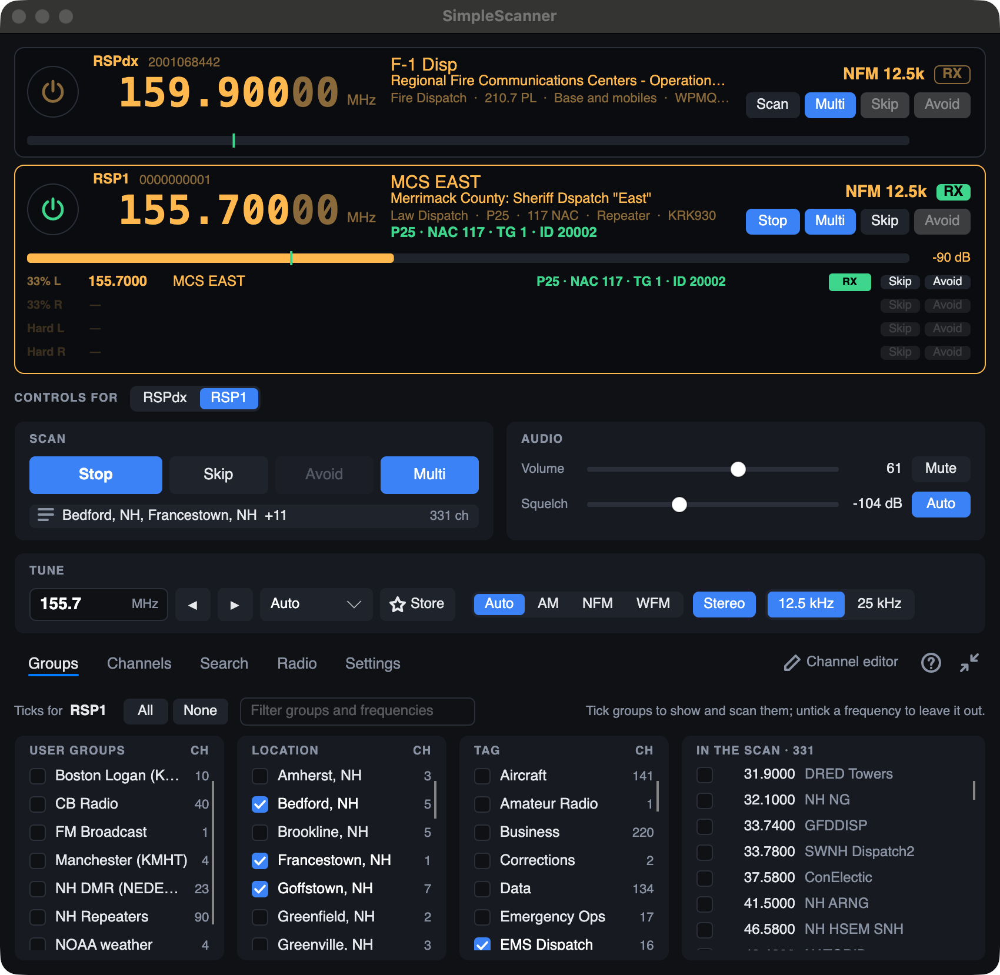
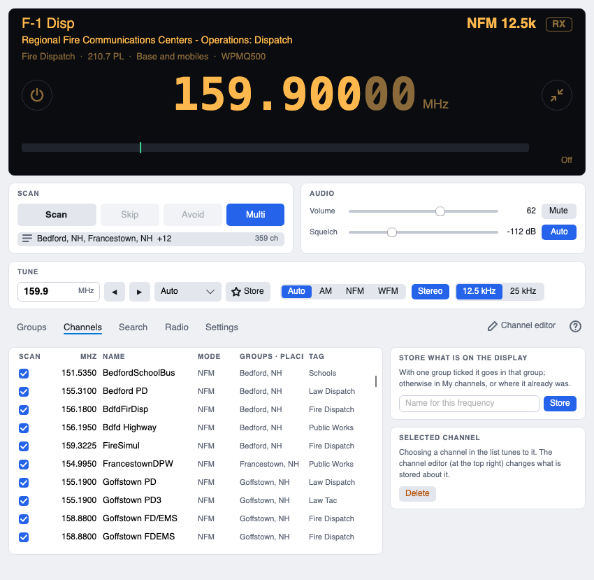
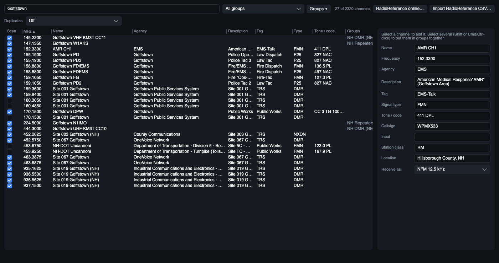

# SimpleScanner

A desktop communications scanner for the SDRplay RSP series of receivers, for Windows, macOS and Linux
(.NET 10, Avalonia). Early days: an analogue receiver with a fast scan, the first five
digital voice modes, and several radios at once.

  

## Screenshots

<table>
  <tr>
    <td width="50%"></td>
    <td width="50%"></td>
  </tr>
  <tr>
    <td>The Light look with one radio, on the Channels tab. The display stays dark like a scanner's LCD.</td>
    <td>The channel editor: filter, edit any field, put channels in groups, or load them from RadioReference.</td>
  </tr>
</table>

The picture at the top is two radios at once: the RSP1 is scanning in Multi Monitor and has stopped on a
P25 dispatch channel, with the NAC, talkgroup and radio ID decoded.

## What works now

- AM (airband, AM broadcast), narrow FM (public service, marine, weather, amateur) and
  broadcast FM, in stereo when the station sends it
- Tuning by typing a frequency, by step buttons, or by rolling the mouse wheel over a digit
- Mode, filter and step chosen from a United States band plan, or by hand
- Squelch, a level bar, and automatic front-end gain
- Stored channels in groups (a channel can be in several), a scan over the groups chosen that
  looks at several megahertz at a time, and a search between two frequencies
- Several radios at once, each with its own display, groups and scan (see "Several radios" below)
- Multi Monitor: a scan that finds several active channels within one tuning of the radio plays
  up to four at once, each from its own place between the speakers (see "Multi Monitor" below)
- The controls used all the time (Scan, Tune, Audio) always in view under the display; groups,
  channels, search, radio and app settings in tabs below them
- On the Groups tab, the frequencies of the groups chosen, each with a tick to take it in or out
  of the scan. A change of tick is taken up by a running scan at once
- Light and Dark: the window follows the macOS appearance, or keeps to one (Settings); the
  display stays dark like a scanner's LCD, or follows the Light look
- Import of RadioReference frequency downloads (the CSV file of a county or an agency), and a
  channel editor: filter the list, edit any field, put channels in groups, and a groups editor
  to make, rename and delete groups (a group made there stays, empty, until channels are put in it)
- A duplicate checker in the channel editor: lists the channels stored more than once (same
  frequency and name, with or without the description, or the same frequency alone), set by set
  with every field, to edit them apart or select the extras and delete them
- A RadioReference browser (the channel editor's "RadioReference online…" button): sign in with
  your own radioreference.com account, give a ZIP code or choose a country, state and county,
  tick the categories and agencies wanted in the tree of what that place has, and load them
  as stored channels. What is fetched is kept on the computer for a week. Telemetry channels are
  stored unticked
- Scan groups the program makes by itself, beside the ones you make: one for each tag in use
  (Fire Dispatch, Law Tac…) and one for each location (a town where RadioReference lists a
  county by town, otherwise the county, "statewide" or "nationwide")
- What is stored about a channel is on the display when the scanner is on it: its name, whose
  it is, and its tag, tone or code, station class, repeater input and callsign
- P25 Phase 1 (conventional): decoded speech, with the NAC, talkgroup and radio ID on the display
- DMR (Tier II conventional: repeaters, and mobiles heard directly): decoded speech, with the
  color code, time slot, talkgroup, radio ID and talker alias. It follows one of the two time
  slots at a time: the first with a call
- NXDN (conventional, both speeds: 4800 bit/s in 6.25 kHz channels and 9600 bit/s in 12.5 kHz):
  decoded speech, with the RAN, talkgroup and radio ID. Calls in NXDN's full-rate voice mode are
  shown and not decoded
- D-STAR digital voice: decoded speech, with the callsigns (who is sending, who is called, which
  repeater) and the transmission's short text message. A transmission joined after its start
  is picked up at the next sync pattern, within half a second
- C4FM (Yaesu System Fusion): decoded speech in the usual DN mode, in full-rate voice (VW) and
  in the other voice and data mode, with the callsigns (who is sending, who is called, which
  repeater) and the digital group ID. A transmission can be joined at any frame
- Encrypted calls are shown and stay silent
- Cellular telephone bands are blocked
- A Help window (the Help tab, or the application menu on macOS): getting started, every tab, the two
  ways of loading from RadioReference, several radios, and the hardware. Its text is
  `src/SimpleScanner/Assets/help.md`

Not yet: trunk following, P25 Phase 2. A stored tone or code (PL, DPL, NAC, color code) is shown, not yet used to decide what
the scan stops on. Trunked-system frequencies in a download are stored unticked.

### Several radios

With more than one RSP plugged in, the scanner can run them together. On the Radio tab, choose a
radio in the Receiver box and switch on "Use at start" for each one wanted; they are started at the next launch.
Each radio, the first included, runs in a helper process of its own, started and ended by the
program (the SDRplay API gives a process one radio, and a radio whose USB link jams is restarted in
a fresh helper).

- Each radio has a strip at the top of the window: power, frequency, channel, mode, level, and its
  own Scan, Skip and Avoid buttons. Click a strip, or its name after "Controls for"
  above the deck, to select that radio. The Scan, Tune and Audio cards and the tabs work the radio
  selected.
- Each radio has its own ticked groups. The groups shown on the Groups tab are those of the radio
  selected, and the tab says whose they are.
- Scan starts and stops the radio selected and leaves the others as they are: one can sit on a
  fixed station while another scans. Each radio scans every ticked channel of its own groups,
  whatever the others scan: radios given the same groups both scan them.
- A channel's own Scan tick (on Channels, and in the frequency list on Groups) is the same for
  every radio.
- Each radio keeps its own settings (antenna, gain, squelch, volume and the rest) under its serial
  number, and has a Pan slider on the Radio tab to put its sound to the left or the right.
- The small window shows every radio's strip.

With one radio the window is as it was, with the one large display.

### Multi Monitor

With the Multi button on (each radio has its own), a scan or search that finds several active
channels in the stretch of band the radio watches from one tuning (about 6.4 MHz) plays up to four
of them at once. Each is placed between the speakers (33% left, 33% right, hard left, hard right);
a signal heard alone plays in the centre and glides to its place when another starts. During the
scan the radio's display gives way to four rows, one per place, with the channel, its details, its
level, a lamp (RX while heard, WAIT while kept for a reply) and its own Skip and Avoid.

- After a signal drops its row keeps the channel for the Multi Monitor Hang Time (Settings, 2 to
  15 seconds), so that a reply is heard on the same row.
- The Resume Timer limits the whole stay in one stretch of band in this mode.
- A strong signal's spill onto the channels beside it is not given a row of its own.
- The main Skip leaves the whole stretch; the main Avoid is not used in this mode.
- Digital voice is decoded on each row.
- A radio's Pan is applied on top of the places; keep it in the middle for the full spread.

### The RadioReference web service

The browser uses RadioReference's database web service, which needs two things: the user's own
RadioReference account with a Premium subscription, and an application key that RadioReference
issues to a program's author. No key is in this repository or in a build: enter the one issued to
you under "Application key…" in the RadioReference window. It is kept in a file
`radioreference.key` beside the settings, readable only by you; the environment variable
`RADIOREFERENCE_KEY` is used in its place when set. The password is kept only if asked, in the macOS login
keychain; on other systems it is asked for at each run. Answers are kept in the program's database,
`simplescanner.db` (SQLite) beside the settings: the same file that holds the stored channels (table
`channels`), whether or not a RadioReference account is used. A `memories.json` from an earlier
version is read into it at the first start and put aside as `memories.json.moved-into-database`.

### The AMBE speech codecs

DMR, NXDN and System Fusion (DN mode) speech is coded with AMBE+2, which is covered by a patent (US 8,359,197, listed as in force
until May 2028). The decoder (mbelib) is therefore a library of its own, `native/ambe`, and a
build can leave it out:

    dotnet build -p:IncludeAmbe=false
    NO_AMBE=1 scripts/make-dmg.sh

The packages on the Releases page include it. Without it the scanner still follows these signals and shows who is talking; the display says
"no voice codec" and the call is silent.

D-STAR uses the older AMBE codec, whose patents have run out. Its decoder is mbelib's too and
lives in the same library, so a build without the library has no D-STAR speech either.

## What you need

- An SDRplay RSPdx or RSPdx-R2 (other single-tuner RSPs stream too). Several can be used at once;
  an RSPdx and an RSP1 together are what has been tried
- The SDRplay API 3.x, from <https://www.sdrplay.com/api/>. It is not included.

## Installing

The packages are on the [Releases](https://github.com/kingsqueak/SimpleScanner/releases) page.
Install the SDRplay API first, on every system.

- **macOS 14 or later**: `SimpleScanner-<version>-arm64.dmg` for Apple silicon, `-x64.dmg` for an
  Intel Mac. Drag SimpleScanner to Applications. It is not notarized by Apple: the first time,
  open System Settings > Privacy & Security and press **Open Anyway**.
- **Windows 10 or 11 (x64)**: `SimpleScanner-<version>-win-x64-setup.exe` installs for your user
  only, with no administrator password. It is not code-signed, so SmartScreen warns the first time
  (More info > Run anyway).
- **Linux, x86-64 or arm64** (arm64 includes a Raspberry Pi 4 or 5 with 64-bit Raspberry Pi OS):
  the `.deb` for Debian, Ubuntu and Raspberry Pi OS (`sudo apt install ./simplescanner_*.deb`), the
  `.rpm` for Fedora and openSUSE, the `.pkg.tar.zst` for Arch. The command is `simplescanner`.

Settings and stored channels are kept in `~/Library/Application Support/SimpleScanner` (macOS),
`%LOCALAPPDATA%\SimpleScanner` (Windows) or `~/.local/share/SimpleScanner` (Linux).

So far SimpleScanner has been used with radios on macOS only. The Windows and Linux packages are
built and started by the CI, but not yet tried with a radio: reports are welcome.

## Building

    dotnet build
    dotnet test
    dotnet run --project src/SimpleScanner            # add "-- --start" to switch the radios on at launch
    scripts/make-dmg.sh [osx-arm64|osx-x64]            # macOS app and DMG
    scripts/make-linux.sh                              # deb, rpm and Arch packages for this machine
    scripts/make-windows.sh                            # Windows program folder (Git Bash, MinGW gcc)

The native libraries are built by the first `dotnet build` on macOS and Linux (on macOS for both
Apple silicon and Intel; on Windows `scripts/make-windows.sh` builds them with MinGW's gcc); they
need a C compiler (gcc or clang): audio output (`native/audio`, miniaudio behind a small C shim),
digital voice (`native/digital`, P25, DMR, NXDN and D-STAR) and the AMBE+2 decoder (`native/ambe`). After
changing C code, run that library's `build.sh` again. The packages are built by the Packages
workflow (`.github/workflows/packages.yml`), run by hand.

`tools/rsp-bench` measures the radio without the window: sample throughput and retune times,
`rsp-bench listen <MHz> [seconds]` to run the receiver on one frequency, or
`rsp-bench hunt <from MHz> <to MHz> [seconds] [squelch]` to list what is on the air in a range
and what kind of signal each is.

## Licence

Copyright (C) 2026 KC2RGW Chris. SimpleScanner is free software under the GNU General Public
License, version 3 or (at your option) any later version: GPL-3.0-or-later, see [LICENSE](LICENSE).

It includes miniaudio (`native/audio/miniaudio.h`, public domain or MIT-0, its authors' choice);
a part of RadioFoundry for the digital voice receivers (`native/digital/radiofoundry`, MIT, with an
IMBE dequantizer from mbelib, ISC); a voice bit table from DSD in the D-STAR receiver (ISC); and the
mbelib AMBE decoders (`native/ambe/mbelib`, ISC). The app is built on Avalonia, SkiaSharp,
CommunityToolkit.Mvvm and Microsoft.Data.Sqlite with SQLite, and uses the Inter typeface. Their
notices ship with the app in [THIRD-PARTY-NOTICES.txt](THIRD-PARTY-NOTICES.txt).

The release packages include the AMBE decoders; see "The AMBE speech codecs" above for the
patent and for how to build without them.

SDRplay and RSP are SDRplay's names; RadioReference is RadioReference.com's. SimpleScanner is not
connected with either. Made by KC2RGW. Bug reports and suggestions are welcome in
[Issues](https://github.com/kingsqueak/SimpleScanner/issues).
